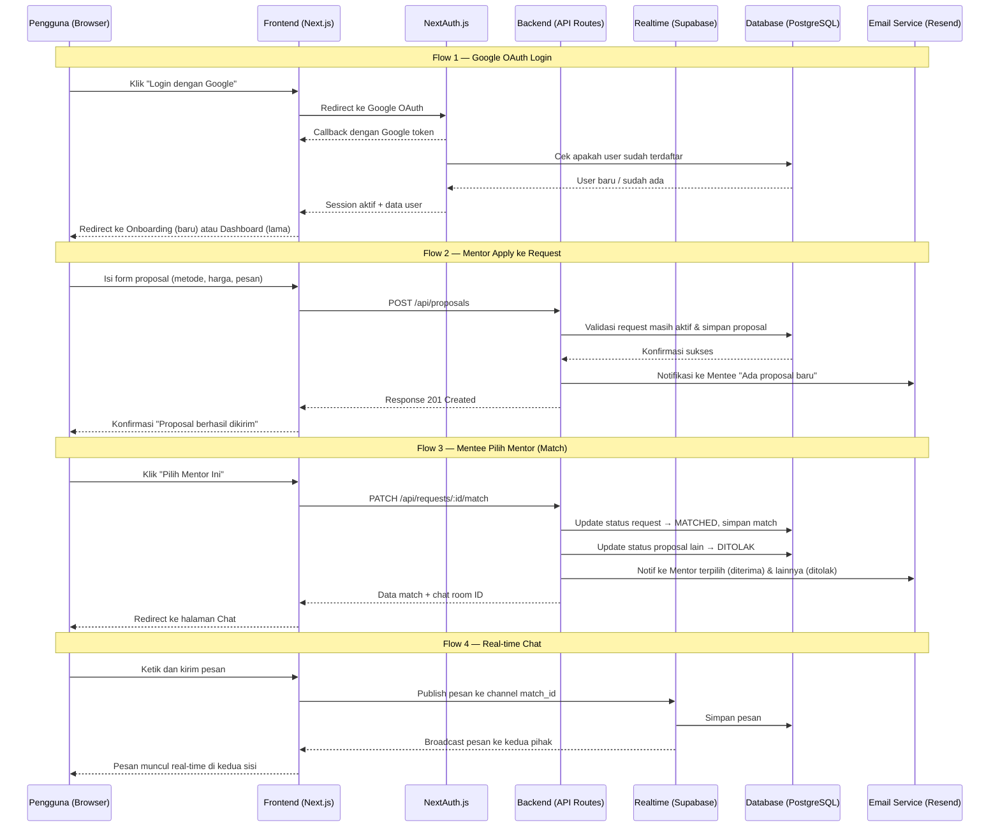
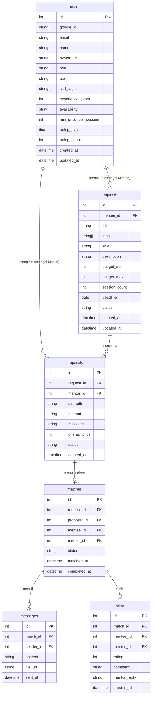

# PRD — Product Requirements Document

**Produk:** Ajarin
**Versi:** 1.1 (MVP)
**Tanggal:** 16 Mei 2026
**Status:** Draft

---

## 1. Overview

Aplikasi ini bertujuan membangun marketplace dua arah berbasis web yang menghubungkan orang yang ingin belajar skill spesifik (**Mentee**) dengan orang yang mampu mengajarkannya (**Mentor**). Masalah utama yang ingin diselesaikan adalah kesulitan menemukan pembelajaran yang benar-benar kontekstual dan personal — bukan kursus video generik, bukan les konvensional — melainkan *matching* berbasis kebutuhan nyata dengan mekanisme proposal/bidding.

Tujuan utama aplikasi adalah menyediakan platform C2C (Consumer-to-Consumer) berbasis web di mana **Mentee** dapat mengajukan request belajar secara spesifik, dan **Mentor** dapat menemukan murid yang serius sesuai keahlian mereka — serta memilih satu sama lain secara transparan sebelum sesi berlangsung.

> **Tagline:** *"Temukan mentor yang tepat, untuk skill yang kamu butuhkan sekarang."*

---

## 2. Problem Statement

Berikut adalah masalah nyata yang dialami pengguna dan menjadi dasar pembangunan platform ini:

| # | Pain Point | Siapa yang Terdampak |
|---|-----------|----------------------|
| 1 | Tutorial online terlalu generik — orang butuh panduan spesifik (contoh: *"Backend Next.js + PostgreSQL untuk project nyata"*) tapi tidak ada yang cukup kontekstual | Mentee |
| 2 | Sulit menemukan mentor yang benar-benar paham kebutuhan spesifik, cocok secara metode, dan sesuai budget | Mentee |
| 3 | Orang dengan skill mumpuni tidak punya kanal efisien untuk menemukan murid yang serius dan terukur | Mentor |

---

## 3. Target Pengguna & Persona

**Model:** C2C (Consumer-to-Consumer)
**Geografi:** Indonesia
**Bahasa Platform:** Basis platform menggunakan Bahasa Inggris (English), dengan fitur penggantian ke Bahasa Indonesia (Bilingual/i18n).

**Segmen awal (MVP):**
- Mahasiswa dan fresh graduate yang mengerjakan project nyata dan butuh bimbingan teknis
- Junior developer dan career switcher yang butuh mentorship tematik
- Profesional yang ingin upgrade skill di luar jam kerja
- Freelancer dan praktisi yang ingin berbagi ilmu sambil menghasilkan pendapatan tambahan

### Persona 1 — Andi, Si Mentee

- **Usia:** 22 tahun, mahasiswa Informatika semester 7
- **Goals:** Menyelesaikan project capstone berbasis Next.js + PostgreSQL
- **Frustrasi:** YouTube terlalu umum, tidak ada yang bisa menjawab error spesifik di codebase-nya
- **Budget:** Rp 100.000 – 300.000 per sesi
- **Ekspektasi:** Mentor yang bisa langsung *nyemplung* ke problemnya, bukan ngajarin dari nol

### Persona 2 — Budi, Si Mentor

- **Usia:** 28 tahun, backend engineer dengan 5 tahun pengalaman
- **Goals:** Dapat penghasilan tambahan sambil memperluas jaringan
- **Frustrasi:** Tidak tahu harus cari murid di mana, takut buang waktu untuk yang tidak serius
- **Ekspektasi:** Platform yang menyaring Mentee serius, transparan soal ekspektasi dan budget

---

## 4. Goals & Success Metrics

### Business Goals

- Membangun marketplace fungsional yang mempertemukan supply (Mentor) dan demand (Mentee) secara efisien.
- Memvalidasi model C2C matching berbasis proposal sebelum menambah fitur monetisasi.
- Mencapai *product-market fit* awal pada segmen tech skill (coding, desain, data).

### Success Metrics (3 Bulan Pertama Post-Launch)

| Metrik | Target | Cara Ukur |
|--------|--------|-----------|
| Registered Users | 500 users | Database count |
| Request aktif di platform | 100 request | Dashboard |
| Match Rate (request → pilih mentor) | ≥ 40% | Matched / Total requests |
| Proposal per Request | ≥ 2 proposal | Avg proposals per request |
| Time to First Match | ≤ 48 jam | Timestamp match - request created |
| Repeat Usage (Mentee buat request ke-2) | ≥ 25% | Cohort analysis |
| Average Rating Post-Sesi | ≥ 4.2 / 5 | Review aggregation |

---

## 5. Requirements

Berikut adalah persyaratan tingkat tinggi untuk pengembangan sistem:

- **Aksesibilitas:** Aplikasi harus dapat diakses melalui Web Browser (desktop dan mobile, dengan prioritas desktop untuk form input).
- **Pengguna:** Sistem memiliki dua peran pengguna — **Mentee** (pencari mentor) dan **Mentor** (pemberi jasa). Mentee dapat langsung mendaftar, sementara calon **Mentor wajib melalui proses verifikasi skill dan disetujui (approve) oleh Admin** sebelum dapat mengirim proposal.
- **Autentikasi:** Login menggunakan akun Google (OAuth 2.0), tidak ada form registrasi email-password manual.
- **Matching:** Sistem tidak otomatis mencocokkan — keputusan ada di tangan Mentee setelah melihat seluruh proposal yang masuk.
- **Komunikasi:** Chat antar pengguna hanya bisa dibuka setelah ada match yang valid.
- **Notifikasi:** Pemberitahuan dikirim via email untuk event penting (apply masuk, match terjadi, pesan baru).
- **Pembayaran:** Tidak ada payment gateway di MVP — transaksi finansial diselesaikan di luar platform.
- **Keamanan:** Semua komunikasi menggunakan HTTPS, data sensitif dienkripsi, dan autentikasi berbasis session token.

---

## 6. Core Features

Fitur-fitur kunci yang harus ada dalam versi pertama (MVP):

### F-01: Auth & Onboarding

- Login dengan Google OAuth 2.0.
- Saat pertama login: pilih role (**Mentee** atau **Mentor**), lalu isi profil dasar.
- Field profil Mentee: nama, foto, bio singkat.
- Field profil Mentor: nama, foto, bio, skill/expertise tags (multi-select), pengalaman (tahun), ketersediaan (hari/jam), dan harga minimum per sesi.
- Role dapat diubah kemudian melalui halaman Settings.

### F-02: Dashboard Pengguna

- **Mentee:** daftar request aktif milik saya, jumlah proposal masuk per request, status setiap request (Aktif / Matched / Selesai).
- **Mentor:** notifikasi request baru yang relevan, history proposal yang sudah dikirim beserta statusnya (Pending / Diterima / Ditolak), dan daftar match aktif.

### F-03: Create Request (Mentee)

Form pengajuan belajar dengan field berikut:

| Field | Tipe | Keterangan |
|-------|------|-----------|
| Judul | Text | Ringkasan kebutuhan, maks. 100 karakter |
| Topik / Tags | Multi-select | Pilih dari daftar + input custom |
| Level Mentee | Radio | Pemula / Menengah / Mahir |
| Deskripsi kebutuhan | Textarea | Min. 100 karakter, spesifik dan kontekstual |
| Budget per sesi | Range | Rp 50.000 – Rp 1.000.000 |
| Jumlah pertemuan | Number | Berapa sesi yang diinginkan |
| Deadline | Date | Kapan harus selesai belajar |
| Status | Auto | Aktif saat dibuat, dapat ditutup manual |

### F-04: Browse & Apply — Mentor

- Halaman list semua request aktif dengan filter: topik/tag, level, dan budget range.
- Urutan default: terbaru. Dapat diurutkan berdasarkan budget tertinggi.
- Halaman detail request menampilkan semua informasi yang diisi Mentee.
- Form apply:

| Field | Tipe | Keterangan |
|-------|------|-----------|
| Keunggulan diri | Textarea | Mengapa Mentee harus memilih saya |
| Metode mengajar | Textarea | Pendekatan, media, dan ritme sesi |
| Penawaran harga | Number | Harga per sesi yang ditawarkan (Rp) |
| Pesan ke Mentee | Textarea | Pesan pembuka / pertanyaan klarifikasi |

- Status proposal: **Pending** → **Diterima** atau **Ditolak** setelah Mentee memilih.
- Satu Mentor hanya dapat mengirim satu proposal per request. Mentor dapat apply ke banyak request, asalkan jadwal sesinya tidak bentrok dengan sesi lain yang sudah disetujui.

### F-05: Proposal Review — Mentee

- Dashboard menampilkan semua Mentor yang sudah apply ke request saya.
- Setiap Mentor tampil sebagai kartu yang berisi: foto, nama, rating, dan preview proposal.
- Tombol "Lihat Profil" membuka profil publik Mentor di tab baru.
- Tombol **"Pilih Mentor Ini"** → trigger match:
  - Status request berubah menjadi **Matched**.
  - Notifikasi email terkirim ke Mentor terpilih (diterima) dan Mentor lainnya (ditolak).
  - Status proposal Mentor lain otomatis berubah menjadi **Ditolak**.

### F-06: Public Mentor Profile

- Halaman profil publik dengan URL unik: `/mentor/[username]`.
- Konten yang ditampilkan: foto, nama, bio, skill tags, pengalaman, harga minimum, ketersediaan, rating rata-rata, dan daftar review.
- Tombol **"Ajukan Request ke Mentor Ini"** untuk Flow B (Mentee apply langsung ke Mentor yang sudah punya listing publik).

### F-07: Basic Messaging — Post-Match

- Chat one-on-one antara Mentee dan Mentor yang sudah matched.
- Fitur yang didukung: kirim teks, kirim link, dan kirim file (PDF, gambar, maks. 5 MB).
- Chat hanya dapat dibuka setelah ada match yang valid.
- Data pesan teks (chat) tidak disimpan secara permanen di database. File atau materi yang diunggah memiliki retensi 1 bulan sebelum dihapus otomatis.

### F-08: Search & Filter

- Search global: cari request atau mentor berdasarkan keyword.
- Filter request: topik, level, budget, status.
- Filter mentor: skill tags, rating minimum, dan ketersediaan.

### F-09: Review & Rating — Post-Sesi

- Penyelesaian sesi diinisiasi oleh Mentor dengan tombol "Validasi Sesi Selesai".
- Mentee harus mengonfirmasi. Jika Mentee tidak memberikan konfirmasi dalam 2x24 jam, sistem akan mengonfirmasi penyelesaian secara otomatis.
- Setelah sesi selesai, Mentee dapat memberi review.
- Field review: rating bintang (1–5) dan ulasan teks (min. 20 karakter).
- Review tampil di profil publik Mentor dan mempengaruhi `rating_avg` di database.
- Mentor dapat membalas review satu kali.

### F-10: Email Notifikasi

Trigger pengiriman email notifikasi:

| Event | Penerima |
|-------|----------|
| Mentor baru apply ke request | Mentee |
| Request saya dipilih (diterima) | Mentor |
| Request saya tidak dipilih (ditolak) | Mentor |
| Ada pesan baru di chat | Mentee atau Mentor |
| Request mendekati deadline (H-2) | Mentee |

### F-11: Pelaporan Pengguna (Report)

- Pengguna (Mentee atau Mentor) dapat melaporkan pihak lain (Report User) jika terjadi pelanggaran, penipuan, atau masalah kenyamanan selama sesi/chat.
- Laporan masuk ke dashboard Admin untuk ditindaklanjuti.

---

## 7. User Flow

### Flow A — Mentee Membuat Request (Primary Flow)

```
[Landing Page]
      ↓
[Login Google] → [Onboarding: Pilih Role = Mentee] → [Isi Profil Dasar]
      ↓
[Dashboard Mentee]
      ↓
[Klik "Buat Request Baru"] → [Isi Form Lengkap] → [Submit] → [Request Aktif]
      ↓
      ←←←← Mentor Browse & Apply ←←←←
      ↓
[Notif Email: "Ada proposal baru"]
      ↓
[Mentee buka Dashboard] → [Lihat daftar Mentor yang apply]
      ↓
[Review profil & proposal tiap Mentor] → [Klik "Pilih Mentor Ini"]
      ↓
[Status: MATCHED] → [Chat terbuka]
      ↓
[Koordinasi jadwal & sesi via Chat]
      ↓
[Sesi berlangsung (di luar platform)]
      ↓
[Mentee tandai sesi selesai] → [Isi Review & Rating]
```

### Flow B — Mentor Onboarding & Kelola Profil

```
[Login Google] → [Onboarding: Pilih Role = Mentor] → [Isi Profil Lengkap]
      ↓
[Dashboard Mentor]
      ↓
[Browse Request Aktif] → [Filter sesuai keahlian] → [Buka Detail Request]
      ↓
[Klik "Apply ke Request Ini"] → [Isi Form Proposal] → [Submit]
      ↓
[Notif Email: "Proposal berhasil dikirim"]
      ↓
      ←←←← Menunggu keputusan Mentee ←←←←
      ↓
[Notif Email: Diterima atau Ditolak]
      ↓ (jika diterima)
[Chat terbuka] → [Koordinasi jadwal & sesi]
      ↓
[Sesi berlangsung] → [Menerima Review dari Mentee]
```

### Edge Case — Request Tidak Mendapat Proposal

```
[Request Aktif selama 7 hari tanpa proposal]
      ↓
[Sistem mengirim notif ke Mentee dan Request di-close secara otomatis (Auto-Close)]
```

---

## 8. Architecture

Berikut adalah gambaran arsitektur sistem dan aliran data secara teknis:



---

## 9. Database Schema

Berikut adalah Entity Relationship Diagram (ERD) yang menggambarkan struktur database utama:



| Tabel | Deskripsi |
|-------|-----------|
| **users** | Master data pengguna, menyimpan info role, profil, ketersediaan, dan agregat rating |
| **requests** | Data request belajar yang dibuat Mentee, mencakup detail kebutuhan, budget, dan status |
| **proposals** | Proposal yang dikirim Mentor ke suatu request, berisi metode, harga, dan status (Pending/Diterima/Ditolak) |
| **matches** | Hasil keputusan Mentee memilih Mentor — menghubungkan request, proposal, dan kedua user |
| **messages** | Pesan chat antar Mentee dan Mentor dalam konteks match tertentu, mendukung teks dan file |
| **reviews** | Ulasan dan rating dari Mentee ke Mentor, termasuk balasan Mentor |

---

## 10. Design & Technical Constraints

Bagian ini mengatur batasan teknis, performa, dan panduan desain yang harus dipatuhi:

### 10.1 High-Level Technology

Sistem dibangun menggunakan teknologi modern yang mendukung pengembangan cepat dan kemudahan pemeliharaan. Stack yang direkomendasikan:

| Layer | Teknologi | Keterangan |
|-------|-----------|-----------|
| Frontend | Next.js 14 (App Router) | SSR + SSG, SEO-friendly untuk public profile |
| Styling | Tailwind CSS + shadcn/ui | Komponen siap pakai, konsisten, customizable |
| Autentikasi | NextAuth.js (Google Provider) | Integrasi mudah, session management |
| Database | PostgreSQL via Supabase | Relasional, cocok untuk data matching |
| ORM | Prisma | Type-safe, migration mudah |
| Real-time Chat | Supabase Realtime | WebSocket tanpa infrastruktur tambahan |
| File Storage | Supabase Storage | Upload file lampiran di chat |
| Email | Resend | Pengiriman email transaksional |
| Hosting | Vercel | Frontend + API Routes |
| Monitoring | Sentry + PostHog | Error tracking + product analytics |

### 10.2 Non-Functional Requirements

| Kategori | Requirement |
|----------|------------|
| **Performa** | Halaman utama (LCP) < 2.5 detik pada koneksi 4G |
| **Availability** | Uptime ≥ 99% (mengikuti SLA Vercel dan Supabase) |
| **Keamanan** | HTTPS wajib, autentikasi via OAuth, data sensitif dienkripsi at rest |
| **Skalabilitas** | Arsitektur mampu menangani 1.000 concurrent users di fase awal |
| **Responsivitas** | Fully responsive, mendukung viewport mulai dari 360px (mobile) |
| **Browser Support** | Chrome, Safari, Firefox, Edge — versi 2 tahun terakhir |
| **Privasi Data** | Tidak menyimpan data kartu kredit di MVP; patuh terhadap UU PDP Indonesia |
| **Aksesibilitas** | Mengikuti WCAG 2.1 Level AA untuk elemen-elemen utama |

### 10.3 Typography Rules

Sistem antarmuka (UI) wajib menggunakan konfigurasi font sebagai berikut untuk menjaga konsistensi visual:

- **Sans:** `Plus Jakarta Sans, ui-sans-serif, sans-serif`
- **Mono:** `JetBrains Mono, ui-monospace, monospace`

### 10.4 Out of Scope (MVP)

Fitur berikut tidak akan dibangun di Phase 1 dan direncanakan untuk fase berikutnya:

| Fitur | Alasan Ditunda |
|-------|---------------|
| Payment gateway & escrow | Kompleksitas regulasi dan integrasi tinggi |
| Video call terintegrasi | Prioritas: validasi matching dulu |
| Kalender booking otomatis | Koordinasi manual via chat sudah cukup di awal |
| Subscription Pro Mentor | Model monetisasi divalidasi post product-market fit |

---

## 11. Risiko & Mitigasi

| Risiko | Kemungkinan | Dampak | Mitigasi |
|--------|-------------|--------|----------|
| Cold start: tidak ada Mentor di awal | Tinggi | Tinggi | Onboard Mentor secara manual via komunitas dev, Discord, dan LinkedIn sebelum launch |
| Request tanpa proposal (sepi) | Sedang | Tinggi | Kirim request ke Mentor terpilih secara manual di fase awal; tambahkan gamification (badge "Mentor Aktif") |
| Kualitas Mentor tidak terjaga | Sedang | Tinggi | Sistem rating ketat, fitur laporan abuse, kurasi manual di awal |
| Pengguna bypass platform (deal di luar) | Tinggi | Sedang | Bangun nilai unik di platform (review, history, trust) sebelum menambah payment |
| Scope creep saat development | Sedang | Sedang | Freeze fitur di awal sprint, backlog dikelola ketat dengan prioritas MVP |

---

## 12. Roadmap & Timeline

### Phase 1 — MVP (Target: 10 Minggu)

| Minggu | Milestone |
|--------|-----------|
| 1–2 | Setup project, desain UI/UX (Figma), database schema, konfigurasi auth |
| 3–4 | Core: Create Request, Browse Request, Apply Proposal |
| 5–6 | Core: Proposal Review, Match Logic, Basic Chat (real-time) |
| 7 | Public Mentor Profile, Search & Filter |
| 8 | Review & Rating, Email Notifikasi |
| 9 | QA, bug fix, performance testing |
| 10 | Soft Launch (closed beta, 50–100 user awal) |

### Phase 2 — Growth (Bulan 3–6)

- Payment gateway (Midtrans / Xendit)
- Dashboard Mentor (kelola semua request dan sesi)
- Fitur Highlight / Boost Request (monetisasi awal)
- Rekomendasi Mentor berbasis riwayat dan tag

### Phase 3 — Scale (Bulan 6–12)

- Mobile App (React Native)
- Kalender dan booking otomatis
- Video call terintegrasi
- Subscription Pro Mentor
- Admin dashboard lengkap

---

*Dokumen ini bersifat living document dan akan diperbarui seiring perkembangan produk.*
*Versi berikutnya (v1.2) akan mencakup hasil riset pengguna (user interview) dan wireframe dari desainer.*
